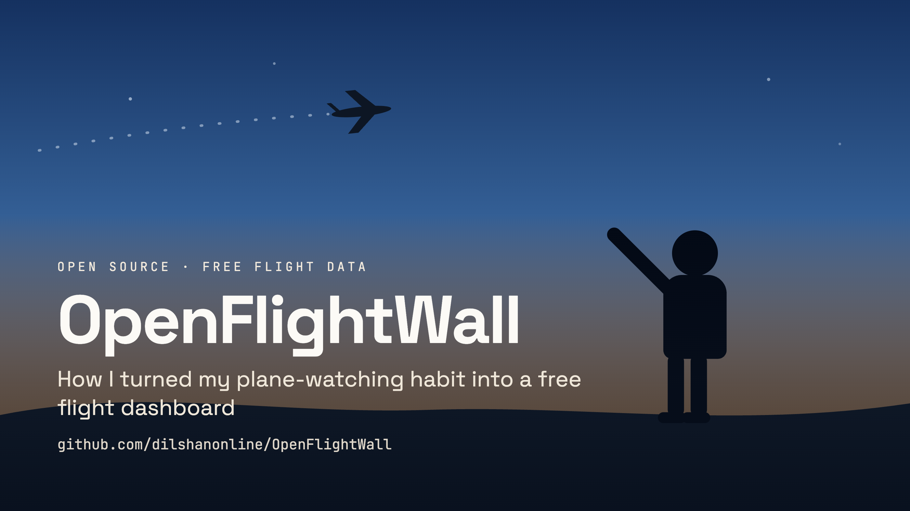
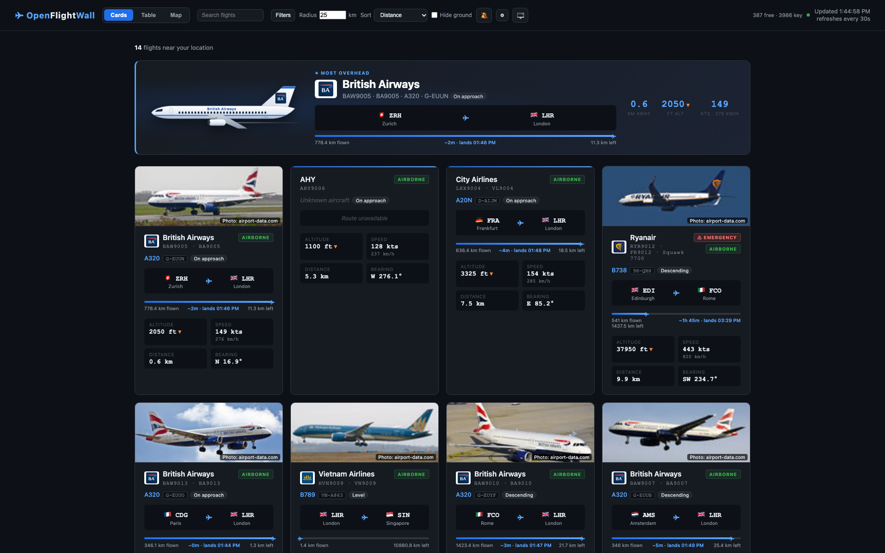
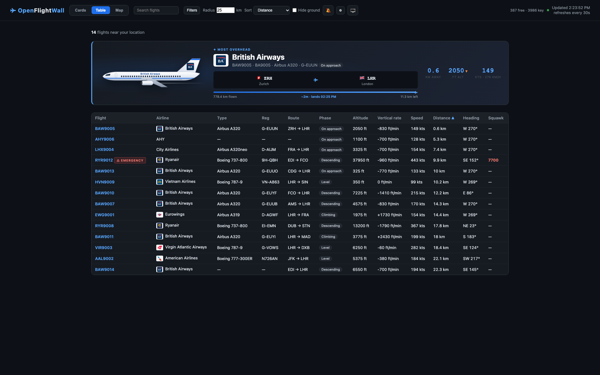
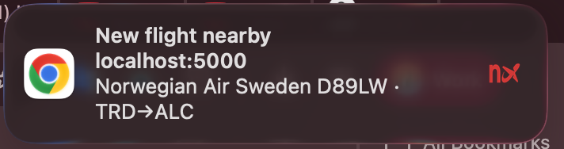
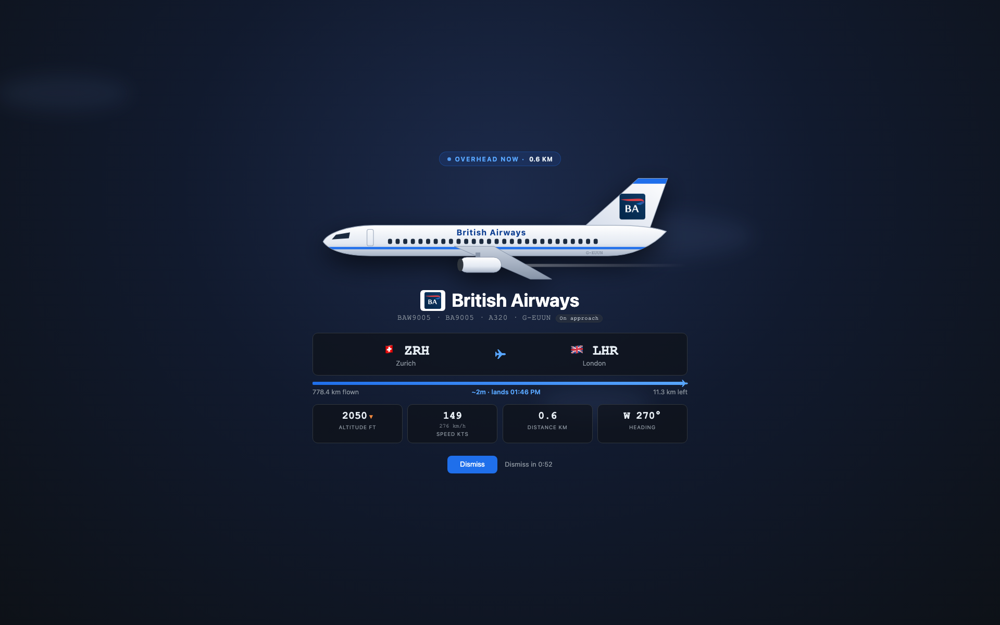
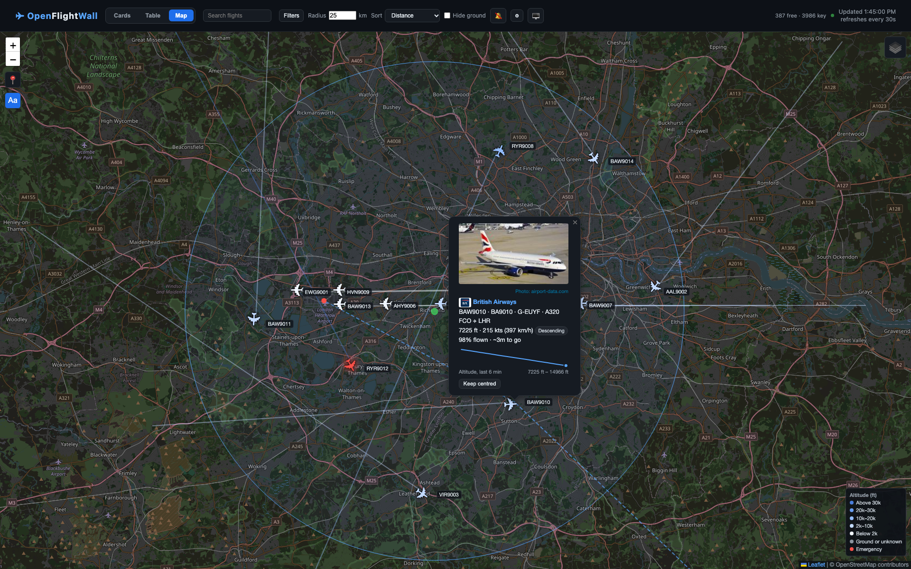
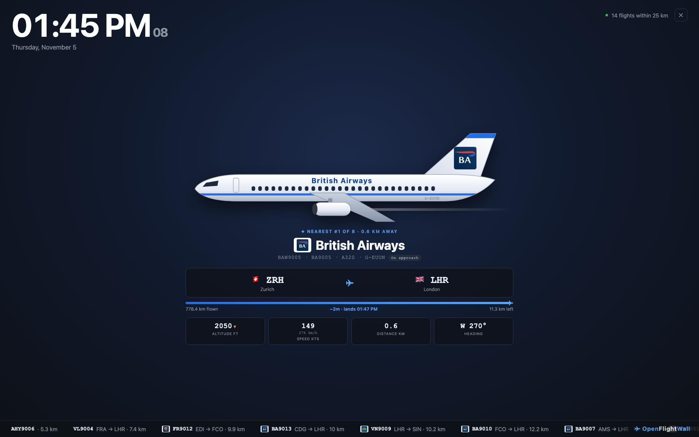
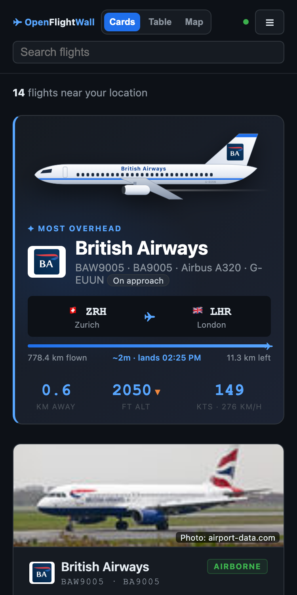
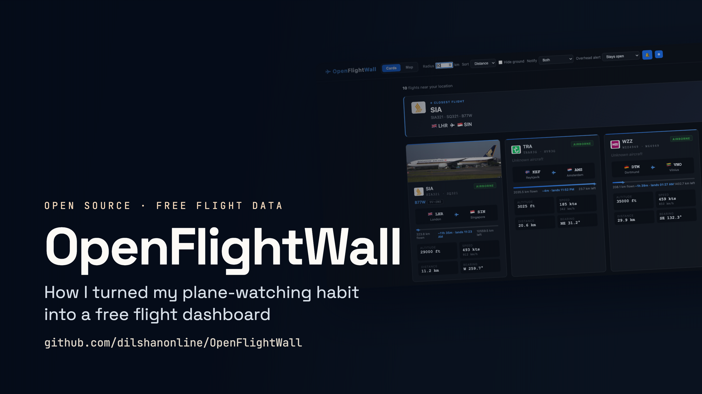

# OpenFlightWall

A zero-cost local web dashboard that shows nearby flights in real time. Runs on your machine via a Python/Flask server — no paid subscriptions required.

**[Try the demo](https://dilshanonline.github.io/OpenFlightWall/demo/)** · **[Project website](https://dilshanonline.github.io/OpenFlightWall/)** — the demo runs the real dashboard in your browser on recorded aircraft positions with sample routes (no install, no server).

**[Read the story](https://medium.com/@dilshanw/openflightwall-how-i-turned-my-plane-watching-habit-into-a-free-flight-dashboard-3b72536adb31)** — how this project came to be, on Medium.



The screenshots use the replay demo's sample callsigns and routes.

**Card View:**


**Table view:**


**Browser notification:**



**Overhead alert:**


**Map view:**


**Wall mode** (for a TV or spare screen):


**On a phone:**



**Keyless by default:** every data source works with no API key or account. The only optional setup is a **free** OpenSky account, which raises the flight-position rate limit (see [Configuration](#configuration)). Nothing here ever costs money. The app runs on your own machine with no telemetry and no OpenFlightWall server in between; any credentials you add are stored locally and only sent to OpenSky. See [Privacy](#privacy) for what each service sees.

## Features

- **Three views** — a responsive flight-card grid, a sortable table, or a live Leaflet/OpenStreetMap map with rotated plane icons; click anywhere on the map to move your location.
- **Full aircraft names** — Airbus A321neo rather than `A21N`, for about 250 common types. Hover over a name on a card, popup or table row to see its code. Other types show the code.
- **Livelier map** — a dark basemap by default (switch back to the standard map from the layer button; your choice is remembered), planes that glide smoothly between updates instead of jumping, a short trail behind each plane, and popups that stay open across refreshes.
- **Vector aircraft art** — the overhead alert, flight banner and wall mode draw the aircraft with the **airline logo on its tail**, the airline name along the fuselage, and the nose pointing the way it is flying. The shape follows the aircraft type: jumbos (747/A380), wide-bodies, narrow-bodies, rear-engine regional jets, business jets, turboprops, light aircraft and helicopters.
- **Origin → destination routes** — full airport names + country flags, plus great-circle route arcs on the map. If a plane is far from the line between the listed airports, the route is marked **Route unverified**, with no progress, ETA or map line.
- **Flight progress + ETA** — progress bar with km flown / remaining and a rough "lands in ~1h 23m" estimate (computed locally). There is no estimate when the plane is still slow with over 300 km to go, since its speed says little about arrival.
- **Aircraft photos & details** — photo, registration, manufacturer and owner from adsbdb.com.
- **Airline logos** — carrier logo on cards, hero banner and map popups (Kiwi.com public CDN).
- **Most-overhead hero banner** — spotlights the plane you are most likely to notice (low and heading towards you) with its vector art, route and progress (the LED-wall vibe).
- **"Overhead now" alert** — full-screen alert when a plane is within ~3 km overhead, with the aircraft art, route, progress and live stats. It **dismisses itself after 1 minute** by default, with a live "Dismiss in M:SS" countdown; pick 30s / 2 / 5 min, or **Stays open**, in ⚙ Settings.
- **Wall mode** — a full-screen display for a TV, Raspberry Pi or spare monitor: a big clock, the nearest flights in turn with large aircraft art, and a scrolling ticker of everything else. It keeps the screen awake where the browser allows. Open it with the 🖥 button, or load `http://localhost:5050/?wall=1` (handy with a kiosk-mode browser); press Esc or ✕ to leave.
- **Works on phones** — on narrow screens the header controls fold into a ☰ panel.
- **Emergency and watchlist alerts** — a banner, sound and notification when a plane squawks 7500, 7600 or 7700, or matches your [watchlist](#watchlist) of callsigns, registrations, types or airlines. Search and filters never hide an alert.
- **New-version alert** — tells you when a newer release is out, with a link to what's new (in the browser, and in the console when you start the server). Turn it off with `OFW_UPDATE_CHECK=0`. See [Update notifications](#update-notifications).
- **Sound ping** — chime when a new flight enters your radius (**on by default**; toggle in the header).
- **Browser notifications** — desktop notifications for **new flights**, **overhead only**, or **both** (**defaults to Both**; prompts for permission on first load, change or disable in ⚙ Settings).
- **Readable map** — altitude colours with a legend, optional callsign labels, keep a plane centred, and an altitude chart in each popup.
- **Keyboard shortcuts** — `/` search, `V` next view, `L` labels, `C` keep centred.
- **Table view** — click a column to sort (your choice is remembered), or a flight to open it on the map. On phones, the Reg, Heading and Squawk columns are hidden.
- **Search and filters** — search by callsign, registration, type, airline, airport or squawk, and filter by aircraft category (airliners, business jets, turboprops, light aircraft, helicopters), altitude and airline. Filters are remembered and also apply to wall mode and the flight banner; search is temporary and only narrows the cards, table and map.
- **Flight phase and units** — climbing, cruising, on approach and so on, with a choice of aviation, metric or mixed units and km, miles or nautical miles (⚙ Settings).
- **Sort** — sort by distance / most overhead / altitude / airline, and a hide-on-ground toggle (labelled header controls). The **Hide ground** toggle is remembered across reloads.
- **Climb/descent + squawk** — ▲/▼ vertical-rate indicator and transponder squawk code.
- **Browser geolocation** — centres on you automatically, with a manual lat/lon entry and click-to-set fallback (no config file).
- **Save location** — optional **Save location** checkbox in ⚙ Settings remembers your location in this browser and reuses it on the next visit, so a manually entered lat/lon does not have to be re-typed after every reload. Off by default; unticking it deletes the stored coordinates. The saved copy stays in the browser. The current location is still used to fetch flights (see [Privacy](#privacy)).
- **Adjustable radius** — change the search radius live from the header.
- **OpenSky account, in-app** — add optional free OpenSky credentials from a ⚙ Settings panel for a higher rate limit (validated live; no restart).
- **Free bucket first** — when a key is set, the app uses the free anonymous quota first and only switches to your account key once the free quota is exhausted (maximising your total daily requests).
- **Credits indicator** — the header shows remaining OpenSky credits for **both** buckets separately (free anonymous ~400/day and your account key ~4000+/day), marking which is currently in use. Updated on each refresh.

> ### Limitations
> | | |
> |---|---|
> | **OpenSky rate limit** | Works keyless, but the anonymous limit is very low (you'll hit `429` quickly). A **free** OpenSky account raises it a lot — see [Configuration](#configuration). A 30 s server cache also helps. |
> | **OpenSky blocks some cloud IPs entirely** | From some cloud/datacenter hosts, *all* connections to OpenSky — anonymous **and** authenticated — fail with a connection timeout, not a `429`. Credentials don't help in this case; see [Hosting in the cloud](#hosting-in-the-cloud). |
> | **Community data sources** | hexdb.io (aircraft type) and adsbdb.com (routes) are community-run with no SLA — some flights may show "Unknown aircraft" or "Route unavailable". |
> | **On-ground aircraft included** | Transponders within the radius are returned, including parked aircraft (use the *Hide ground* toggle). Ground traffic with no callsign is left out because it is often vehicles, and so is any position older than 5 minutes. |
> | **Routes can be wrong** | adsbdb looks routes up by callsign, so a reused callsign can show the wrong airports. The *Route unverified* label catches the obvious cases, but it can also flag a correct route during a diversion or long detour. |

---

## Prerequisites

- Python **3.11+**
- A way to install dependencies — [uv](https://docs.astral.sh/uv/getting-started/installation/) is used for development, but `pyproject.toml` is a plain, standard PEP 621 file with no tool lock-in. Use uv, pip, Poetry, Pipenv, Conda, or whatever you prefer.

**Dependencies:** Flask 3.x, Requests 2.x, and python-dotenv 1.x.

---

## Quickstart

### Run with uv

```bash
uv sync
uv run python app.py
```

`uv sync` creates the local `.venv` and installs the exact dependency versions
recorded in `uv.lock`.

### Alternative — pip

```bash
python -m venv .venv
source .venv/bin/activate   # Windows: .venv\Scripts\activate
pip install flask requests python-dotenv
python app.py
```

### Other tools (Poetry, Pipenv, Conda, etc.)

There's nothing uv- or pip-specific about this project — `pyproject.toml` is a plain PEP 621 file, so any tool that reads one will work, e.g.:

```bash
poetry install
poetry run python app.py
```

Prefer a different workflow, or want to add first-class docs/lockfile support for another tool? PRs are very welcome.

### Or run the prebuilt Docker image

No Python setup needed:

```bash
docker run -p 5050:5050 dilshanonline/openflightwall:latest
```

See [Docker](#docker) below for OpenSky credentials, port config, and image tags.

**Open your browser**
```
http://localhost:5050
```

The browser will ask for permission to use your location. **Allow it** and the dashboard shows flights around you. If you deny (or geolocation is unavailable), a prompt lets you **enter your latitude/longitude manually** — or open the **Map** view and click anywhere to drop your location.

The dashboard auto-refreshes every 30 seconds.

---

## Configuration

Location and radius are set in the browser (no config file needed):

| Setting | Where | Notes |
|---|---|---|
| Location | Browser geolocation, manual lat/lon entry, or map click | Detected automatically on first load; tick **Save location** in ⚙ Settings to reuse it next time |
| Search radius | Radius input in the header (default **10 km**) | Change it live; flights re-fetch immediately. Always in km, whichever units you choose |
| Units | ⚙ Settings | Aviation (ft, kts), metric (m, km/h) or mixed (ft, km/h), plus km, miles or nautical miles |
| Browser notifications | ⚙ Settings | Off, new flights, overhead only, or both (default) |
| Overhead alert | ⚙ Settings | Stays open, or dismisses after 30 s, 1 min (default), 2 min or 5 min |
| Watchlist | ⚙ Settings | See [Watchlist](#watchlist) |
| Sound | 🔔 button in the header | On by default; browsers need one click on the page before the first ping |
| Filters, sort, Hide ground | Header | Filters and Hide ground are remembered in this browser |

The only server-side settings are optional environment variables (or a `.env` file — see `.env.example`):

| Variable | Default | What it does |
|---|---|---|
| `OPENSKY_CLIENT_ID` / `OPENSKY_CLIENT_SECRET` | unset | Free OpenSky account for a higher rate limit (below) |
| `OFW_UPDATE_CHECK` | `1` | Set to `0` to never ask GitHub whether a newer release exists |
| `OFW_DATA_DIR` | next to `app.py` (`/data` in Docker) | Folder for credentials saved from ⚙ Settings |
| `FLASK_DEBUG` | unset | Set to `1` for Flask's debugger and auto-reload, for development only |
| `PORT` | `5050` | Docker image only: the port the container listens on. `python app.py` always uses 5050 |

### Watchlist

Add one entry per line in ⚙ Settings to get the same banner, sound and notification as an emergency when a matching plane enters your radius:

| Entry | Matches |
|---|---|
| `callsign:BAW1` | Callsigns or flight numbers starting with `BAW1` |
| `reg:G-XLEA` | That registration |
| `type:A388` | That ICAO type code (the code, not the full name) |
| `airline:EK` | That airline code, or an airline name containing the text |
| `G-XLEA` | A plain value matches any of the above |

Each alert fires once per plane, and again only if the plane has been gone for 30 minutes. The list is stored in your browser only.

### Update notifications

OpenFlightWall tells you when a newer version is out:

- **How it checks:** the server reads its own version from `pyproject.toml` and asks GitHub's public API for the latest release. The answer is cached for 6 hours, so GitHub sees at most a few requests a day from your server.
- **What is sent:** a plain request to `api.github.com` that names the running version in its `User-Agent` (e.g. `OpenFlightWall/1.1.1`). No location, flight data or credentials. GitHub sees your IP address, as with any web request.
- **When it checks:** when the dashboard loads, then once a day while it stays open, so a wall-mode screen left running for weeks still gets the notice. The server re-asks GitHub at most every 6 hours, so a new release shows up within about a day.
- **Where it shows:** a small notice at the bottom of the dashboard with a "What's new" link, and the running version in the ⚙ panel. **Dismiss** hides the notice until the next release. `uv run python app.py` also prints a one-line notice in the console at startup. The Docker image doesn't print it, so look for the notice in the browser.
- **To update:** run `git pull && uv sync` and restart, or `docker pull dilshanonline/openflightwall:latest` and recreate the container.
- **To turn it off:** set `OFW_UPDATE_CHECK=0` and GitHub is never contacted.

### Optional: OpenSky account (recommended — avoids rate limits)

The app works **anonymously with no setup**, but OpenSky's anonymous API has a
*very* low rate limit — you'll hit `429 Too Many Requests` quickly. A **free**
OpenSky account raises the limit substantially.

First, get credentials:

1. Register at [opensky-network.org](https://opensky-network.org/) and sign in.
2. Open your [account page](https://opensky-network.org/my-opensky/account) → **API client** → create a new client.
3. Copy the `client_id` and `client_secret`.

Then add them **either** way:

**Option 1 — In the UI (easiest, no restart)**
- Click the **⚙ Settings** button in the header, paste the Client ID and Secret, and hit **Save & validate**.
- The app tests the credentials with OpenSky, stores them locally, and switches to the higher limit immediately. Use **Clear** to revert to keyless.

**Option 2 — `.env` file or environment variables**
```bash
cp .env.example .env
```
```dotenv
OPENSKY_CLIENT_ID=your-client-id
OPENSKY_CLIENT_SECRET=your-client-secret
```
Restart the server; it prints `OpenSky access: authenticated (OAuth)` on startup.

> **Where secrets live:** UI-saved creds go in `opensky_creds.json`; the file
> option uses `.env`. Both are **git-ignored** and stored in plain text on
> your machine only. UI-saved creds take precedence over env vars.

---

## Data Sources

All sources are **free**. The server contacts OpenSky, hexdb.io, adsbdb.com and GitHub; your browser loads the images, map and map library directly. Only OpenSky optionally uses a (free) account for a higher rate limit; everything else is keyless.

| Source | What it provides | URL |
|---|---|---|
| OpenSky Network | Real-time ADS-B positions, callsign, altitude, speed, heading | `opensky-network.org/api/states/all` |
| hexdb.io | Aircraft type code (e.g. `B738`) from ICAO24 hex; adsbdb.com is the fallback | `hexdb.io/api/v1/aircraft/{icao24}` |
| adsbdb.com | Flight route + IATA flight number + airline telephony; and aircraft registration/owner/manufacturer/**photo** | `api.adsbdb.com/v0/callsign/{callsign}`, `.../v0/aircraft/{icao24}` |
| Kiwi.com images | Airline logos by 2-letter IATA code | `images.kiwi.com/airlines/64/{IATA}.png` |
| airport-data.com | Aircraft photos, linked from adsbdb.com's records | `image.airport-data.com` |
| OpenStreetMap | Map tiles | `tile.openstreetmap.org` |
| unpkg | The Leaflet map library | `unpkg.com/leaflet@1.9.4` |
| GitHub API | Latest release, for the new-version alert (cached 6 h; opt out with `OFW_UPDATE_CHECK=0`) | `api.github.com/repos/dilshanonline/OpenFlightWall/releases/latest` |

### Privacy

There are no accounts, analytics or telemetry, but the app does need to ask these services for data, and each one sees your IP address:

| Service | What it receives |
|---|---|
| OpenSky | An area box centred on your location, plus your credentials if you added any |
| hexdb.io, adsbdb.com | The aircraft hex codes and callsigns near you |
| GitHub | Your running version, unless `OFW_UPDATE_CHECK=0` |
| OpenStreetMap | The map tiles for the area you view |
| Kiwi.com, airport-data.com, unpkg | Requests for logos, photos and the map library |

Your location goes from the browser to your own OpenFlightWall server on each refresh. The app doesn't save it there, though `python app.py` prints each request, including the coordinates, to its console. Credentials saved from ⚙ Settings are stored in plain text on that server.

---

## What Each Flight Card Shows

| Field | Source | Notes |
|---|---|---|
| Airline name | adsbdb.com | Full name when known; otherwise the first letters of the callsign (e.g. `UAL`), which can look odd for private planes |
| Airline logo | Kiwi.com CDN | Shown by IATA code; hidden if none exists |
| Callsign + flight number | OpenSky + adsbdb.com | e.g. `ACA850 · AC850` (IATA flight number shown when known) |
| Aircraft type | hexdb.io + built-in names | Full name for common types (e.g. `B738` shows as Boeing 737-800), otherwise the ICAO type code |
| Origin → Destination | adsbdb.com | Airport codes + city + country flag; "Route unavailable" if unknown |
| Flight progress + ETA | Computed | Progress bar, km flown/remaining, rough "lands in ~" estimate (great-circle, constant speed) |
| Aircraft photo & registration | adsbdb.com | Photo banner + registration/owner/manufacturer where available |
| Altitude | OpenSky | Barometric altitude in your chosen units, with ▲/▼ climb/descent indicator |
| Speed | OpenSky | Ground speed in your chosen units |
| Flight phase | Computed | Climbing, cruising, level, descending, on approach or on ground |
| Distance | Computed | Haversine distance from your centre point, in your chosen units |
| Bearing | Computed | Direction from you (e.g. `NE 42°`) |
| Squawk | OpenSky | Transponder code, shown when reported |
| Airborne / Ground | OpenSky | `on_ground` flag from ADS-B transponder |

---

## Project Structure

```
OpenFlightWall/
├── app.py              # Flask server + full data pipeline
├── pyproject.toml      # Project metadata and dependencies
├── uv.lock             # Reproducible dependency lockfile
├── Dockerfile          # Image published to Docker Hub
├── .env.example        # Template for optional settings
├── CHANGELOG.md        # Release history
├── AGENTS.md           # Architecture notes and project rules
├── templates/
│   ├── index.html      # Frontend (vanilla HTML/CSS/JS + Leaflet)
│   └── aircraft_names.js  # Type code → full name table, included into index.html
├── site/               # Project website and replay demo (GitHub Pages)
└── docs/screenshots/   # Images used here and on the website
```

---

## How It Works

```
[Browser] ──polls every 30s──▶ GET /api/flights?lat&lon&radius
                                     │
                              Flask (app.py)
                                     │
          ┌──────────────┬──────────┼──────────────┐
          ▼              ▼          ▼              ▼
    OpenSky anon     hexdb.io   adsbdb.com     (Haversine
  (state vectors) (aircraft) (route, photo) distance/bearing)
          │              │          │              │
          └──────────────┴──────────┴──────────────┘
                                     │
                           Enriched JSON array
                                     │
                     [Browser renders cards / map]
```

Routes and aircraft types are cached server-side for 1 hour (they rarely change); the full flight list is cached for 30 s to respect OpenSky's rate limit.

---

## Troubleshooting

**No flights showing?**
- Increase the **Radius** in the header (try `50`–`100` km)
- Confirm your detected location is correct (open the Map view)
- OpenSky may return empty results in low-traffic airspace

**OpenSky returns `429 Too Many Requests`**
- The 30 s server-side cache prevents this under normal use
- Avoid changing the **radius** rapidly (the input is debounced, but each distinct radius is a separate request)
- For a much higher limit, add free OpenSky credentials — see *Configuration → Optional: OpenSky account* above
- The app serves the last results and auto-retries on the next 30 s poll

**Aircraft showing as "Unknown aircraft" or "Route unavailable"**
- hexdb.io / adsbdb.com don't have every registration or callsign — this is expected and harmless
- Private/military/GA aircraft often have no public route records

**A route says "Route unverified"**
- The plane is far from the line between its listed airports, so the callsign may have been reused and the route may be wrong. It can also appear during a diversion or long detour.

**An aircraft shows a code rather than a full name**
- That type isn't in the name table yet. Add it to `templates/aircraft_names.js`; PRs are welcome.

**Saved OpenSky credentials are gone after updating the Docker container**
- Run the container with a volume so they survive being replaced: `-v openflightwall-data:/data`

**Location not detected / map shows the wrong place**
- A prompt will appear to enter your latitude/longitude manually
- Or open the **Map** view and click anywhere to drop your location
- macOS: enable **System Settings → Privacy & Security → Location Services** for your browser
- If you clicked *Block*, re-allow location via the 🔒/ⓘ icon in the address bar
- Use `http://localhost:5050` (not a LAN IP) — geolocation needs a secure context. On another device, such as a wall screen, enter the location manually and tick **Save location**

**Browser notifications not appearing**
- A ⚠ in the header, repeated beside **Browser notifications** in ⚙ Settings, names whichever layer is blocking — hover it
- macOS: System Settings → **Notifications** → your browser must have *Allow Notifications* on and an alert style other than **None**; also turn off any **Focus / Do Not Disturb** mode
- The browser can report success while the OS silently drops the banner — that is what the ⚠ detects
- Re-allow notifications via the 🔒/ⓘ icon in the address bar if you previously blocked them
- Use `http://localhost:5050` (not a LAN IP) — notifications need a secure context, same as geolocation

**Server error on startup**
- Ensure the uv environment is installed and current: `uv sync`

---

## Docker

Prebuilt multi-arch images (`linux/amd64` + `linux/arm64`) are published to Docker Hub on every tagged release:

```bash
docker run -p 5050:5050 \
  -e OPENSKY_CLIENT_ID=your-client-id \
  -e OPENSKY_CLIENT_SECRET=your-client-secret \
  dilshanonline/openflightwall:latest
```

- `OPENSKY_CLIENT_ID`/`OPENSKY_CLIENT_SECRET` are optional — omit them to run keyless.
- Credentials can also be set at runtime from the ⚙ Settings panel in the UI instead of env vars — no restart needed. They're written to `/data/opensky_creds.json` inside the container. To keep them when the container is replaced, add a named volume: `-v openflightwall-data:/data`.
- The container listens on the `PORT` env var (default `5050`); set it if you need a different internal port, and adjust `-p` to match.
- Tags: `latest` (newest release), plus semantic versions like `1.2.0`, `1.2`, `1` for pinning.
- Runs behind [gunicorn](https://gunicorn.org/) in the image — the local `uv run python app.py` dev workflow above is unaffected and still uses Flask's own dev server.

### Hosting in the cloud

OpenFlightWall is meant to run on your own network — a laptop, home server or Raspberry Pi works best. If you host it with a cloud provider instead, be aware that OpenSky blocks outbound connections from some cloud/datacenter IP ranges at the network level: requests time out rather than returning a clean `429`, which shows up as a `500` from `/api/flights`. Adding OpenSky credentials does **not** help, because the block happens before any request connects. Check that your host can reach `opensky-network.org` before relying on it; a non-datacenter connection is the only known workaround. PRs improving on this are welcome.

---

## Contributing

Contributions are welcome — bug fixes, new free/keyless data sources, UI improvements, docs for your favorite package manager, all of it. Open an issue or a PR. The one hard rule: this project stays zero-cost, so no paid APIs or required API keys (see [AGENTS.md](AGENTS.md) for the full constraints and an architecture overview if you're using an AI coding assistant). See [CHANGELOG.md](CHANGELOG.md) for a history of notable changes.

### Releasing (maintainers)

1. Bump `version` in `pyproject.toml` — it is what the in-app update alert compares against.
2. In `CHANGELOG.md`, rename `## [Unreleased]` to `## [X.Y.Z] - YYYY-MM-DD`.
3. Merge to `main`, then tag the merged commit: `git tag vX.Y.Z && git push origin vX.Y.Z`.
4. The Docker Publish workflow checks the tag matches `pyproject.toml`, builds and pushes the multi-arch image, and only then publishes a GitHub Release with that version's changelog notes. Running apps pick it up within about a day.

The full checklist (version bump with `uv lock`, PR, tagging `main`, verifying, and recovering from a failed run) is in [AGENTS.md → Release Process](AGENTS.md#release-process).

---

## License

Apache License 2.0 — see [LICENSE](LICENSE).

## Credits

Built by [Dilshan Wijesooriya](https://dilshanwijesooriya.me/) ([GitHub](https://github.com/dilshanonline)) — inspired by [TheFlightWall](https://github.com/AxisNimble/TheFlightWall_OSS).


